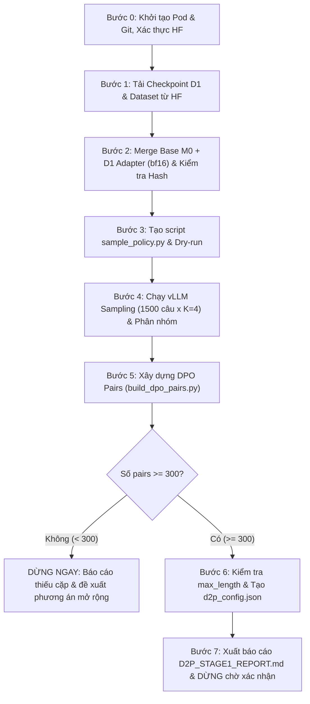

# Kế hoạch Thực thi D2' Tự động (Bước 1 & Bước 2) trên RunPod RTX 4090

Tài liệu này được thiết kế như một **Actionable Agent Instruction File** để Antigravity (hoặc agent AI) có thể đọc và tự động thực thi tuần tự từ đầu đến cuối toàn bộ **Bước 1 (Sampling)** và **Bước 2 (Pair Construction)** theo quy định trong [content.md](file:///Users/hau/Downloads/mm/content.md), [HANDOFF_D2p.md](file:///Users/hau/Downloads/mm/work/train_RL_20261106/HANDOFF_D2p.md), [PLAN_D2p.md](file:///Users/hau/Downloads/mm/work/train_RL_20261106/PLAN_D2p.md) và [handoff_D2p_message.md](file:///Users/hau/Downloads/mm/handoff_D2p_message.md).

---

## ⚡ CẤP QUYỀN TỰ QUYẾT CHO ANTIGRAVITY (AUTONOMOUS EXECUTION MANDATE)

> [!IMPORTANT]
> **ỦY QUYỀN THỰC THI TOÀN QUYỀN TỪ NGƯỜI DÙNG:**
> Người dùng cấp toàn quyền tự quyết cho Antigravity tự động thực thi mọi lệnh terminal (`run_command`), thao tác file (đọc, tạo, ghi đè, sửa đổi mã nguồn), thiết lập môi trường venv, tải checkpoint/dataset, quản lý tiến trình GPU mà **KHÔNG CẦN DỪNG LẠI HỎI XÁC NHẬN Ở TỪNG BƯỚC**.
> 
> **Antigravity CHỈ dừng lại trong 4 trường hợp sau:**
> 1. Phát hiện GPU không phải **RTX 4090**.
> 2. SHA-256 của weights/adapter/shards không khớp với mã băm chuẩn.
> 3. Tổng số cặp DPO preference tạo được **< 300 cặp** (Quy tắc dừng bắt buộc theo kế hoạch).
> 4. Đã hoàn thành toàn bộ Bước 1 & Bước 2 và xuất xong file báo cáo [reports/D2P_STAGE1_REPORT.md](file:///Users/hau/Downloads/mm/work/train_RL_20261106/reports/D2P_STAGE1_REPORT.md) (Dừng chờ người dùng duyệt trước khi chuyển sang Bước 3 - Huấn luyện A100).

---

## ⏱️ BẢNG THEO DÕI TIẾN ĐỘ & THỜI GIAN ƯỚC TÍNH (PROGRESS & TIMELINE)

Antigravity **BẮT BUỘC** in ra thông báo trạng thái `[BẮT ĐẦU: GIAI ĐOẠN X/8]` và `[HOÀN THÀNH: GIAI ĐOẠN X/8]` ra màn hình chat ở từng giai đoạn để người dùng luôn biết mình đang ở bước nào và cần chờ bao lâu.

| Giai đoạn | Nội dung công việc | Ước lượng thời gian | Đầu ra kiểm tra |
| :---: | :--- | :---: | :--- |
| **0/8** | Khởi tạo Pod, cấu hình Git, kiểm tra GPU RTX 4090 & tạo `merge_env` | **~1 - 2 phút** | GPU RTX 4090 xác nhận, Git sẵn sàng |
| **1/8** | Tải D1 adapter, dataset `hypB-rl-data`, ảnh A và base model snapshot | **~3 - 5 phút** | Hash adapter `2d4bcce4...` khớp |
| **2/8** | Merge Base M0 + D1 Adapter sang bf16 trên CPU/RAM & đối chiếu SHA-256 | **~4 - 6 phút** | 2 shards safetensors khớp 100% |
| **3/8** | Tạo `sample_policy.py` từ `sample_m0.py` & chạy CPU dry-run kiểm tra | **~1 - 2 phút** | File diff hợp lệ, dry-run 5 câu pass |
| **4/8** | **(Bước 1 content.md)** Chạy vLLM Sampling 1.500 câu × K=4 = 6.000 outputs, chấm reward realtime, phân nhóm Target/Keep/Discard | **~3.0 - 3.5 giờ** | `runs/d2p_k4/raw.jsonl` (6.000 dòng), `d2p_train.jsonl` |
| **5/8** | **(Bước 2 content.md)** Xây dựng DPO pairs bằng `build_dpo_pairs.py` | **~2 - 3 phút** | `data/d2p_pairs_swift.jsonl` |
| **6/8** | Kiểm tra quy tắc dừng (< 300 cặp), kiểm tra max token length & tạo config train | **~1 - 2 phút** | Đạt ≥ 300 cặp, `scripts/d2p_config.json` |
| **7/8** | Lập bảng so sánh M0 vs D1, xuất báo cáo `reports/D2P_STAGE1_REPORT.md` | **~1 phút** | Báo cáo hoàn chỉnh tại `reports/` |
| **8/8** | Hoàn tất Bước 1 & 2, tóm tắt kết quả cho người dùng & **DỪNG CHỜ XÁC NHẬN** | **Tức thì** | Trạng thái sẵn sàng cho Bước 3 trên A100 |

*Tổng thời gian dự kiến: ~3.5 đến 4.0 giờ (trong đó ~3 giờ 20 phút là thời gian vLLM sinh 6.000 outputs trên RTX 4090).*

---

## ⚠️ CÁC NGUYÊN TẮC BẢO MẬT & AN TOÀN BẮT BUỘC (DO & DON'T)

1. **Bảo mật Token tuyệt đối**:
   - KHÔNG lưu cứng token GitHub hay Hugging Face vào file này hay git repository.
   - GitHub Token và Hugging Face Token sẽ do người dùng tự cung cấp qua biến môi trường hoặc thiết lập thủ công khi SSH vào máy chủ.
   - Scripts đọc Hugging Face Token an toàn từ biến môi trường `HF_TOKEN`.
2. **Không upload adapter hay data lên GitHub public**:
   - Mọi dữ liệu và weights của dự án là private. Không bao giờ commit weights/data lên git public.
3. **Không chỉnh sửa script gốc**:
   - Giữ nguyên bản `scripts/sample_m0.py`. Khi cần chạy policy D1, copy sang `scripts/sample_policy.py` và CHỈ bổ sung option đường dẫn mô hình.
4. **Quy tắc dừng bắt buộc (Stop Rules)**:
   - Nếu GPU không phải RTX 4090 -> **DỪNG và báo cáo**.
   - Nếu SHA-256 của weights/adapter không khớp -> **DỪNG và báo cáo**.
   - Nếu tổng số DPO pairs ở Bước 2 **< 300 cặp** -> **DỪNG NGAY LẬP TỨC và báo cáo, không chuẩn bị training**.
   - Sau khi hoàn thành Bước 1 & Bước 2 và xuất báo cáo `reports/D2P_STAGE1_REPORT.md` -> **DỪNG TẠI ĐÂY**, chờ người dùng kiểm tra và xác nhận trước khi chuyển sang Bước 3 (A100 Training).
5. **Không tự ý tắt Pod**: Tuyệt đối không chạy lệnh `runpodctl stop/terminate` hay tương tự.

---

## BẢNG THÔNG SỐ KỸ THUẬT D2' (GIAI ĐOẠN 1 & 2)

| Tham số | Giá trị quy định | Ghi chú |
| :--- | :--- | :--- |
| **GPU mục tiêu** | NVIDIA GeForce RTX 4090 (24GB VRAM) | Duy trì tính nhất quán với baseline |
| **Base Model (M0)** | `Qwen/Qwen3-VL-4B-Instruct` | Revision: `ebb281ec70b05090aa6165b016eac8ec08e71b17` |
| **D1 Adapter** | Repo: `MMDL-team4/hypB-d1-dpo` (nhánh `run-yoonseok`) | Hash adapter: `2d4bcce4972b36b6ef49b0b73d46c9d72a3803f43632b6847ae6f4d65e0132e8` |
| **Dữ liệu Sampling** | Repo: `MMDL-team4/hypB-rl-data` (nhánh `run-yoonseok`) | 1.500 câu hỏi trong `data/r1_pool.jsonl`, ảnh B/C |
| **Ảnh tập A** | Repo: `MMDL-team4/hypB-train-data` v1.1 | Commit: `1833bac3be047aa8bd146492436323bb7c14092a` |
| **Số lượng output** | 1.500 câu hỏi × K=4 = 6.000 mẫu | Seed yêu cầu: 3407 |
| **Hyperparameters Sampling** | Temp: 0.7, Top-p: 0.8, Top-k: 20, Presence Penalty: 1.5 | Max new tokens: 8192, Context len: 16384 |
| **Chấm điểm trực tiếp** | `reward_v2.py` | Tính reward (1 hoặc 0) cho 6.000 mẫu |
| **Ngưỡng dừng Pairs** | ≥ 300 cặp | Dưới 300 cặp phải dừng lại báo cáo |

---

## QUY TRÌNH THỰC THI CHI TIẾT (STEP-BY-STEP)



---

### GIAI ĐOẠN 0: KHỞI TẠO POD, CẤU HÌNH GIT VÀ KIỂM TRA MÔI TRƯỜNG (ƯỚC TÍNH: ~1 - 2 PHÚT)
*Antigravity xuất thông báo: `[BẮT ĐẦU: GIAI ĐOẠN 0/8] Khởi tạo Pod, cấu hình Git và kiểm tra môi trường RTX 4090 (Ước tính: ~1-2 phút)`*

#### 0.1. Cấu hình Git với Credentials của OnlyDev321
Chạy các lệnh cấu hình trên RunPod (thay `<YOUR_GITHUB_TOKEN>` bằng GitHub token của bạn):
```bash
git config --global user.name "OnlyDev321"
git config --global user.email "onlydev.321@gmail.com"
git config --global credential.helper store
echo "https://OnlyDev321:<YOUR_GITHUB_TOKEN>@github.com" > ~/.git-credentials
chmod 600 ~/.git-credentials
```

#### 0.2. Clone Repository về máy Pod (nếu chưa clone)
```bash
cd /workspace
if [ ! -d "/workspace/mm" ]; then
    git clone https://github.com/OnlyDev321/mm.git /workspace/mm
fi
cd /workspace/mm
```

#### 0.3. Kiểm tra GPU & Môi trường Python / PyTorch
Thực hiện preflight check:
```bash
python3.12 - << 'EOF'
import sys, torch
print("Python version:", sys.version.split()[0])
assert sys.version_info >= (3, 11), "Yêu cầu Python >= 3.11"
assert torch.cuda.is_available(), "CUDA không khả dụng!"
gpu_name = torch.cuda.get_device_name(0)
print("GPU phát hiện:", gpu_name)
assert "4090" in gpu_name, f"LỖI: GPU phải là RTX 4090, hiện tại là {gpu_name}!"
print("PREFLIGHT GPU PASS: Đang chạy trên NVIDIA RTX 4090")
EOF
```

#### 0.4. Thiết lập Hugging Face Token & Đăng nhập
Trước khi chạy, hãy export token của bạn trong terminal (hoặc đã export từ trước):
```bash
export HF_TOKEN="<YOUR_HF_TOKEN>"
export HF_HOME=/workspace/hf_cache
```

Kiểm tra xác thực Hugging Face:
```bash
python3.12 - << 'EOF'
import os, sys
from huggingface_hub import HfApi, login

token = os.environ.get("HF_TOKEN")
if not token:
    print("❌ LỖI: Biến môi trường HF_TOKEN chưa được thiết lập!")
    print("Vui lòng chạy: export HF_TOKEN=\"<huggingface_token>\" trước khi thực thi.")
    sys.exit(1)

login(token=token, add_to_git_credential=True)

api = HfApi(token=token)
user = api.whoami()
print(f"✅ Hugging Face Authentication Thành công! Đăng nhập với user: {user.get('name')}")
EOF
```

#### 0.5. Chuẩn bị môi trường Merge (venv riêng tránh conflict)
```bash
export HF_HOME=/workspace/hf_cache
mkdir -p /workspace/hf_cache
cd /workspace/mm/work/train_RL_20261106

# Tạo merge_env nếu chưa có
if [ ! -d "merge_env" ]; then
    python3.12 -m venv --system-site-packages merge_env
    merge_env/bin/python -m pip install --no-deps peft==0.17.1
fi
```

---

### GIAI ĐOẠN 1: TẢI CHECKPOINT D1, DATASET & KIỂM TRA HASH (ƯỚC TÍNH: ~3 - 5 PHÚT)
*Antigravity xuất thông báo: `[BẮT ĐẦU: GIAI ĐOẠN 1/8] Tải Checkpoint D1, Dataset và kiểm tra SHA-256 (Ước tính: ~3-5 phút)`*

Tất cả dữ liệu được lưu vào đúng cây thư mục chuẩn: `/workspace/mm/work/train_RL_20261106/`.

#### 1.1. Script Tải Checkpoint D1 (`MMDL-team4/hypB-d1-dpo`)
Tải adapter D1 và đối chiếu SHA-256 của `adapter_model.safetensors`:
```bash
python3.12 - << 'EOF'
import os, hashlib
from pathlib import Path
from huggingface_hub import snapshot_download

token = os.environ.get("HF_TOKEN")
assert token, "Biến môi trường HF_TOKEN chưa được thiết lập! Hãy chạy export HF_TOKEN='...'"
adapter_dir = Path("/workspace/mm/work/train_RL_20261106/adapter/d1_full")
adapter_dir.mkdir(parents=True, exist_ok=True)

print("Đang tải D1 adapter từ MMDL-team4/hypB-d1-dpo (nhánh run-yoonseok)...")
path = snapshot_download(
    repo_id="MMDL-team4/hypB-d1-dpo",
    repo_type="model",
    revision="run-yoonseok",
    local_dir=adapter_dir,
    token=token
)

def sha256(p):
    with open(p, "rb") as f:
        return hashlib.file_digest(f, "sha256").hexdigest()

adapter_weight = adapter_dir / "adapter_model.safetensors"
assert adapter_weight.exists(), "Không tìm thấy adapter_model.safetensors!"
h = sha256(adapter_weight)
EXPECTED_HASH = "2d4bcce4972b36b6ef49b0b73d46c9d72a3803f43632b6847ae6f4d65e0132e8"
print(f"SHA-256 adapter_model.safetensors: {h}")
assert h == EXPECTED_HASH, f"Hash không khớp! Kỳ vọng {EXPECTED_HASH}, thực tế {h}"
print("✅ D1 Adapter SHA-256 HỢP LỆ!")
EOF
```

#### 1.2. Script Tải Dữ liệu Sampling & Scripts (`MMDL-team4/hypB-rl-data`)
Tải 1.500 câu hỏi, ảnh B/C, các script (`sample_m0.py`, `build_groups.py`, `reward_v2.py`, `build_dpo_pairs.py`):
```bash
python3.12 - << 'EOF'
import os
from pathlib import Path
from huggingface_hub import snapshot_download

token = os.environ.get("HF_TOKEN")
assert token, "Biến môi trường HF_TOKEN chưa được thiết lập! Hãy chạy export HF_TOKEN='...'"
work_dir = Path("/workspace/mm/work/train_RL_20261106")

print("Đang tải dữ liệu RL từ MMDL-team4/hypB-rl-data (nhánh run-yoonseok)...")
path = snapshot_download(
    repo_id="MMDL-team4/hypB-rl-data",
    repo_type="dataset",
    revision="run-yoonseok",
    local_dir=work_dir,
    token=token
)

assert (work_dir / "data/r1_pool.jsonl").exists(), "Thiếu file data/r1_pool.jsonl"
assert (work_dir / "scripts/sample_m0.py").exists(), "Thiếu script sample_m0.py"
assert (work_dir / "scripts/build_groups.py").exists(), "Thiếu script build_groups.py"
assert (work_dir / "scripts/build_dpo_pairs.py").exists(), "Thiếu script build_dpo_pairs.py"
assert (work_dir / "scripts/reward_v2.py").exists(), "Thiếu script reward_v2.py"
print("✅ Đã tải và xác thực toàn bộ scripts và dữ liệu từ hypB-rl-data!")
EOF
```

#### 1.3. Tải Ảnh Tập A (`MMDL-team4/hypB-train-data` v1.1)
```bash
python3.12 - << 'EOF'
import os
from pathlib import Path
from huggingface_hub import snapshot_download

token = os.environ.get("HF_TOKEN")
assert token, "Biến môi trường HF_TOKEN chưa được thiết lập! Hãy chạy export HF_TOKEN='...'"
images_a_dir = Path("/workspace/mm/work/train_RL_20261106/data/images_A")
images_a_dir.mkdir(parents=True, exist_ok=True)

print("Đang tải ảnh tập A từ MMDL-team4/hypB-train-data (v1.1 / 1833bac3)...")
snapshot_download(
    repo_id="MMDL-team4/hypB-train-data",
    repo_type="dataset",
    revision="1833bac3be047aa8bd146492436323bb7c14092a",
    local_dir=images_a_dir,
    token=token
)
print("✅ Hoàn tất tải ảnh tập A!")
EOF
```

---

### GIAI ĐOẠN 2: MERGE MÔ HÌNH D1 (M0 + D1 ADAPTER -> BF16) & KIỂM TRA HASH (ƯỚC TÍNH: ~4 - 6 PHÚT)
*Antigravity xuất thông báo: `[BẮT ĐẦU: GIAI ĐOẠN 2/8] Merge Base M0 + D1 Adapter sang bf16 & kiểm tra shard hash (Ước tính: ~4-6 phút)`*

Theo ghi nhận từ đợt chạy A100 và eval_D1, việc merge được thực hiện trên CPU/RAM và lưu thành các safetensors shard. Shard hashes bắt buộc phải khớp 100% với bản ghi D1.

#### 2.1. Thực hiện Merge
Chạy bằng `merge_env` (chứa `peft==0.17.1`):
```bash
cd /workspace/mm/work/train_RL_20261106
merge_env/bin/python - << 'EOF'
import os, sys, shutil, hashlib, json
from pathlib import Path
from tempfile import TemporaryDirectory
import torch
from peft import PeftModel
from transformers import Qwen3VLForConditionalGeneration
from huggingface_hub import snapshot_download
from safetensors import safe_open

BASE = "Qwen/Qwen3-VL-4B-Instruct"
REV = "ebb281ec70b05090aa6165b016eac8ec08e71b17"
ROOT = Path("/workspace/mm/work/train_RL_20261106")
ADAPTER = ROOT / "adapter/d1_full"
OUT = Path("/workspace/models/D1")

print("1. Tải Base Model snapshot...")
base_path = Path(snapshot_download(BASE, revision=REV, token=os.environ.get("HF_TOKEN")))

print("2. Nạp Base Model sang BF16 SDPA trên CPU...")
model = Qwen3VLForConditionalGeneration.from_pretrained(
    base_path,
    dtype=torch.bfloat16,
    attn_implementation="sdpa",
    device_map="cpu"
)

print("3. Nạp Adapter D1 và Merge...")
adapted = PeftModel.from_pretrained(model, ADAPTER)
merged = adapted.merge_and_unload(safe_merge=True)

print("4. Lưu mô hình Merged...")
OUT.parent.mkdir(parents=True, exist_ok=True)
if OUT.exists():
    shutil.rmtree(OUT)

with TemporaryDirectory(dir=OUT.parent) as tmp:
    tmp_out = Path(tmp) / "merged"
    merged.save_pretrained(tmp_out, safe_serialization=True)
    # Copy các file tokenizer, jinja, txt nguyên bản
    for f in base_path.iterdir():
        if f.suffix in {".json", ".jinja", ".txt"} and f.name not in {"config.json", "model.safetensors.index.json"}:
            shutil.copyfile(f, tmp_out / f.name)
    tmp_out.rename(OUT)

print("5. Xác minh SHA-256 các Shard...")
def sha(p):
    with open(p, "rb") as f:
        return hashlib.file_digest(f, "sha256").hexdigest()

hashes = {}
for path in sorted(OUT.glob("*.safetensors")):
    hashes[path.name] = sha(path)

print("Các shard tạo ra:", json.dumps(hashes, indent=2))

EXPECTED_SHARDS = {
    "model-00001-of-00002.safetensors": "31d4561504484269e16e1cc00baef16d694cd44f25c9d282cfd45977caaab351",
    "model-00002-of-00002.safetensors": "1280742e74baab97037603e9bc2912626f2c85d6347d9762a1286566b4b7f431"
}

assert hashes == EXPECTED_SHARDS, f"LỖI: Shard hash không khớp với bản ghi D1!\nKỳ vọng: {EXPECTED_SHARDS}\nThực tế: {hashes}"
print("🎉 D1 MERGED SHARD HASHES MATCH 100%! Ready for vLLM.")
EOF
```

---

### GIAI ĐOẠN 3: TẠO SCRIPT SAMPLING MÔ HÌNH POLICY (`scripts/sample_policy.py`) (ƯỚC TÍNH: ~1 - 2 PHÚT)
*Antigravity xuất thông báo: `[BẮT ĐẦU: GIAI ĐOẠN 3/8] Tạo scripts/sample_policy.py và chạy CPU dry-run (Ước tính: ~1-2 phút)`*

Nguyên tắc bất biến: **Tuyệt đối không sửa `sample_m0.py` gốc**. Ta copy sang `sample_policy.py` và chỉ thêm đối số `--model-path` trỏ tới `/workspace/models/D1`.

```bash
cd /workspace/mm/work/train_RL_20261106

# Copy nguyên bản
cp scripts/sample_m0.py scripts/sample_policy.py

# Bổ sung tham số --model-path vào scripts/sample_policy.py bằng Python script an toàn
python3.12 - << 'EOF'
from pathlib import Path

target = Path("scripts/sample_policy.py")
content = target.read_text(encoding="utf-8")

# Thêm argument model-path vào parser nếu chưa có
if "--model-path" not in content:
    # Chèn argument vào ArgumentParser
    anchor = "parser.add_argument("
    insert_code = 'parser.add_argument("--model-path", type=str, default="/workspace/models/D1", help="Path to merged D1 model")\n    '
    content = content.replace(anchor, insert_code + anchor, 1)
    
    # Thay thế đường dẫn load model mặc định sang args.model_path
    content = content.replace('"Qwen/Qwen3-VL-4B-Instruct"', 'args.model_path')
    target.write_text(content, encoding="utf-8")
    print("✅ Đã cập nhật scripts/sample_policy.py thành công!")
else:
    print("scripts/sample_policy.py đã có --model-path.")
EOF

# Xuất diff giữa 2 file để lưu vào báo cáo
diff -u scripts/sample_m0.py scripts/sample_policy.py > reports/sample_policy.diff || true
cat reports/sample_policy.diff
```

---

### GIAI ĐOẠN 4: THỰC HIỆN SAMPLING VỚI vLLM TRÊN RTX 4090 (BƯỚC 1 TRONG CONTENT.MD) (ƯỚC TÍNH: ~3.0 - 3.5 GIỜ)
*Antigravity xuất thông báo: `[BẮT ĐẦU: GIAI ĐOẠN 4/8] Chạy vLLM Sampling 1.500 câu hỏi × K=4 = 6.000 mẫu trên RTX 4090 (Ước tính: ~3.0 - 3.5 giờ). Đây là giai đoạn chạy inference lớn, hệ thống sẽ log tiến độ liên tục.`*

#### 4.1. Chạy Sampling 1.500 câu hỏi × K=4 (6.000 outputs)
Chạy vLLM với đầy đủ các siêu tham số của R1 giai đoạn 3:
```bash
cd /workspace/mm/work/train_RL_20261106
mkdir -p runs/d2p_k4

python3.12 scripts/sample_policy.py \
    --model-path /workspace/models/D1 \
    --data data/r1_pool.jsonl \
    --output runs/d2p_k4/raw.jsonl \
    --k 4 \
    --temperature 0.7 \
    --top-p 0.8 \
    --top-k 20 \
    --presence-penalty 1.5 \
    --max-new-tokens 8192 \
    --max-model-len 16384 \
    --seed 3407 \
    --reward-v2
```

#### 4.2. Phân loại Group (Target, Keep, Discard) & Tạo tập Train
```bash
cd /workspace/mm/work/train_RL_20261106

# Phân nhóm câu hỏi
python3.12 scripts/build_groups.py \
    --input runs/d2p_k4/raw.jsonl \
    --output-groups runs/d2p_k4/groups.json \
    --output-train runs/d2p_k4/d2p_train.jsonl \
    --seed 3407

# Tạo checksum cho các file kết quả
python3.12 - << 'EOF'
import json, hashlib
from pathlib import Path

run_dir = Path("runs/d2p_k4")
sums = {}
for p in ["raw.jsonl", "groups.json", "d2p_train.jsonl"]:
    f = run_dir / p
    if f.exists():
        with open(f, "rb") as fp:
            sums[p] = hashlib.file_digest(fp, "sha256").hexdigest()

(run_dir / "SHA256SUMS.json").write_text(json.dumps(sums, indent=2) + "\n")
print("SHA256SUMS.json đã được tạo:\n", json.dumps(sums, indent=2))
EOF
```

---

### GIAI ĐOẠN 5: XÂY DỰNG DPO PREFERENCE PAIRS (BƯỚC 2 TRONG CONTENT.MD) (ƯỚC TÍNH: ~2 - 3 PHÚT)
*Antigravity xuất thông báo: `[BẮT ĐẦU: GIAI ĐOẠN 5/8] Xây dựng DPO Preference Pairs bằng build_dpo_pairs.py (Ước tính: ~2-3 phút)`*

#### 5.1. Chạy Tạo Pairs
Quy tắc cặp:
- `Chosen`: trả lời đúng (`reward == 1`) và không bị cắt (`finish_reason != 'length'`).
- `Rejected`: ưu tiên `length` (bị cắt) > `wrong`/`fallback_wrong` (kết thúc bình thường nhưng trả lời sai) > `extract_fail` (không trích xuất được đáp án).
- Tối đa 2 cặp cho mỗi câu hỏi, không tái sử dụng cùng một response, random seed 3407.

```bash
cd /workspace/mm/work/train_RL_20261106
mkdir -p data

python3.12 scripts/build_dpo_pairs.py \
    --raw runs/d2p_k4/raw.jsonl \
    --groups runs/d2p_k4/groups.json \
    --train runs/d2p_k4/d2p_train.jsonl \
    --output data/d2p_pairs_swift.jsonl \
    --seed 3407
```

#### 5.2. KIỂM TRA QUY TẮC DỪNG BẮT BUỘC (STOP RULE: < 300 PAIRS)
```bash
python3.12 - << 'EOF'
import sys, json
from pathlib import Path

pairs_path = Path("data/d2p_pairs_swift.jsonl")
assert pairs_path.exists(), "File data/d2p_pairs_swift.jsonl không tồn tại!"

num_pairs = sum(1 for _ in open(pairs_path, "r", encoding="utf-8"))
print(f"Tổng số DPO pairs tạo được: {num_pairs}")

if num_pairs < 300:
    print(f"🚨 [DỪNG BẮT BUỘC]: Số lượng cặp preference ({num_pairs}) NHỎ HƠN 300!")
    print("Theo quy định PLAN_D2p mục 3: Dừng ngay, không tiến hành chuẩn bị training.")
    print("Phương án đề xuất tiếp theo: Mở rộng pool dữ liệu (kết hợp MMFR SFT split pass_rate 0.25~0.5).")
    sys.exit(2)
else:
    print(f"✅ ĐẠT YÊU CẦU: Số cặp ({num_pairs} >= 300). Tiếp tục bước tiếp theo.")
EOF
```

---

### GIAI ĐOẠN 6: KIỂM TRA ĐỘ DÀI TOKEN & TẠO CẤU HÌNH TRAINING (`scripts/d2p_config.json`) (ƯỚC TÍNH: ~1 - 2 PHÚT)
*Antigravity xuất thông báo: `[BẮT ĐẦU: GIAI ĐOẠN 6/8] Kiểm tra quy tắc dừng (< 300 cặp), độ dài token và tạo d2p_config.json (Ước tính: ~1-2 phút)`*

```bash
cd /workspace/mm/work/train_RL_20261106

python3.12 - << 'EOF'
import json
from pathlib import Path
from transformers import AutoTokenizer

pairs_path = Path("data/d2p_pairs_swift.jsonl")
tokenizer = AutoTokenizer.from_pretrained("/workspace/models/D1", trust_remote_code=True)

max_tok = 0
pairs_count = 0
for line in open(pairs_path, "r", encoding="utf-8"):
    row = json.loads(line)
    # Tính độ dài chosen và rejected
    msg_len = len(tokenizer.encode(str(row.get("messages", ""))))
    rej_len = len(tokenizer.encode(str(row.get("rejected_response", ""))))
    cur_max = msg_len + rej_len
    if cur_max > max_tok:
        max_tok = cur_max
    pairs_count += 1

print(f"Chuỗi dài nhất thực tế trong {pairs_count} cặp là: {max_tok} tokens")

if max_tok <= 10240:
    chosen_max_length = 10240
    pilot_needed = False
elif max_tok <= 12288:
    chosen_max_length = max_tok + 512
    pilot_needed = True
    print(f"⚠️ Chuỗi dài nhất ({max_tok}) vượt 10,240! Thiết lập max_length = {chosen_max_length} và CẦN MEMORY PILOT.")
else:
    print(f"❌ LỖI: Chuỗi dài nhất ({max_tok}) vượt giới hạn 12,288 tokens! Dừng và báo cáo.")
    exit(1)

# Tạo cấu hình training d2p_config.json dựa trên dpo_config.json
dpo_cfg_file = Path("scripts/dpo_config.json")
if dpo_cfg_file.exists():
    cfg = json.loads(dpo_cfg_file.read_text())
else:
    # Config chuẩn DPO
    cfg = {
        "model": "/workspace/models/D1",
        "rlhf_type": "dpo",
        "train_type": "lora",
        "lora_rank": 16,
        "lora_alpha": 32,
        "lora_dropout": 0.05,
        "learning_rate": 5e-6,
        "beta": 0.1,
        "rpo_alpha": 1.0,
        "num_train_epochs": 2,
        "per_device_train_batch_size": 1,
        "gradient_accumulation_steps": 16,
        "seed": 3407
    }

cfg["model"] = "/workspace/models/D1"
cfg["custom_dataset"] = ["data/d2p_pairs_swift.jsonl"]
cfg["max_length"] = chosen_max_length

Path("scripts/d2p_config.json").write_text(json.dumps(cfg, indent=2) + "\n")
print(f"✅ Đã tạo scripts/d2p_config.json với max_length = {chosen_max_length}")
EOF
```

---

### GIAI ĐOẠN 7: TỔNG HỢP SỐ LIỆU & XUẤT BÁO CÁO `reports/D2P_STAGE1_REPORT.md` (ƯỚC TÍNH: ~1 PHÚT)
*Antigravity xuất thông báo: `[BẮT ĐẦU: GIAI ĐOẠN 7/8] Tổng hợp số liệu so sánh M0 vs D1 và xuất báo cáo reports/D2P_STAGE1_REPORT.md (Ước tính: ~1 phút)`*

Tạo script tự động thống kê và ghi ra báo cáo [D2P_STAGE1_REPORT.md](file:///Users/hau/Downloads/mm/work/train_RL_20261106/reports/D2P_STAGE1_REPORT.md):
```bash
cd /workspace/mm/work/train_RL_20261106
mkdir -p reports

python3.12 - << 'EOF'
import json
from pathlib import Path

# Đọc thống kê từ runs/d2p_k4
raw_file = Path("runs/d2p_k4/raw.jsonl")
groups_file = Path("runs/d2p_k4/groups.json")
pairs_file = Path("data/d2p_pairs_swift.jsonl")

# Thống kê câu hỏi & câu trả lời
questions_stats = {}
total_outputs = 0
truncated_count = 0
correct_count = 0

for line in open(raw_file, "r", encoding="utf-8"):
    row = json.loads(line)
    qid = row.get("id", row.get("question_id"))
    reward = row.get("reward", 0)
    reason = row.get("reward_reason", row.get("finish_reason", ""))
    
    if qid not in questions_stats:
        questions_stats[qid] = {"correct": 0, "total": 0}
    questions_stats[qid]["total"] += 1
    if reward == 1:
        questions_stats[qid]["correct"] += 1
        correct_count += 1
    if "length" in str(reason) or "truncated" in str(reason):
        truncated_count += 1
    total_outputs += 1

correct_dist = {i: 0 for i in range(5)}
for qid, st in questions_stats.items():
    c = st["correct"]
    if c in correct_dist:
        correct_dist[c] += 1

groups_data = json.loads(groups_file.read_text()) if groups_file.exists() else {}
target_cnt = len(groups_data.get("target", []))
keep_cnt = len(groups_data.get("keep", []))
discard_cnt = len(groups_data.get("discard", []))

pairs_cnt = sum(1 for _ in open(pairs_file, "r", encoding="utf-8")) if pairs_file.exists() else 0

report_content = f"""# Báo cáo D2' Giai đoạn 1 & 2 (Sampling & Pair Construction)

- **Mô hình Policy:** D1 Merged (`Qwen3-VL-4B-Instruct` + D1 adapter `2d4bcce4...`)
- **GPU Sampling:** NVIDIA GeForce RTX 4090
- **Tổng số câu hỏi:** {len(questions_stats):,} câu
- **Tổng số câu trả lời sinh ra:** {total_outputs:,} (K=4)
- **Số câu bị cắt (Length Truncated):** {truncated_count:,} ({truncated_count/total_outputs*100:.2f}%)
- **Số câu trả lời đúng (Reward = 1):** {correct_count:,} ({correct_count/total_outputs*100:.2f}%)

## 1. Phân bố số câu đúng trên mỗi câu hỏi (0 đến 4)

| Số câu đúng / 4 | Số lượng câu hỏi (D1 Policy) | Số lượng câu hỏi (M0 Baseline) |
| :---: | :---: | :---: |
| 0/4 | {correct_dist[0]:,} | 162 |
| 1/4 | {correct_dist[1]:,} | 140 |
| 2/4 | {correct_dist[2]:,} | 159 |
| 3/4 | {correct_dist[3]:,} | 249 |
| 4/4 | {correct_dist[4]:,} | 790 |

## 2. Phân loại Group & Tập Train

- **Target (표적 - có cả đúng và sai/cắt):** {target_cnt:,} câu
- **Keep (유지 - toàn bộ đúng):** {keep_cnt:,} câu
- **Discard (제외 - toàn bộ sai/lỗi):** {discard_cnt:,} câu
- **Tổng câu hỏi đưa vào DPO:** {target_cnt + keep_cnt:,} câu

## 3. Kết quả Xây dựng Preference Pairs

- **Tổng số cặp preference tạo được:** **{pairs_cnt:,} cặp**
- **Quy tắc dừng ≥ 300 cặp:** {'✅ ĐẠT CHUẨN' if pairs_cnt >= 300 else '❌ KHÔNG ĐẠT'}
- **Cấu hình training đã tạo:** `scripts/d2p_config.json`

## 4. Hành động tiếp theo

> **LƯU Ý:** Giai đoạn 1 và 2 đã hoàn tất thành công. Dừng tại đây và gửi báo cáo này cho người phụ trách/nhóm.
> **CHỈ bật máy RunPod A100 và tiến hành Giai đoạn 3 (Training) sau khi báo cáo này được phê duyệt.**
"""

Path("reports/D2P_STAGE1_REPORT.md").write_text(report_content, encoding="utf-8")
print("✅ Báo cáo reports/D2P_STAGE1_REPORT.md đã được tạo thành công!")
EOF
```

---

### GIAI ĐOẠN 8: DỪNG VÀ BÁO CÁO KẾT THÚC BƯỚC 2 (CHỜ DUYỆT TRƯỚC KHI TRAIN A100)
*Antigravity xuất thông báo: `[HOÀN THÀNH TOÀN BỘ: GIAI ĐOẠN 8/8] Đã hoàn tất Bước 1 (Sampling) và Bước 2 (Pair Construction). Báo cáo đã sẵn sàng. DỪNG TẠI ĐÂY chờ bạn duyệt trước khi chuyển sang Bước 3.`*

Sau khi `reports/D2P_STAGE1_REPORT.md` được tạo:
1. Agent in tóm tắt kết quả (số cặp DPO, bảng phân bố đúng/sai).
2. **Dừng toàn bộ tool execution**.
3. Yêu cầu người dùng kiểm tra báo cáo và xác nhận trước khi chuyển sang Bước 3 (Training trên A100).
4. Giữ nguyên Pod, không tắt máy.

